# ggPSE 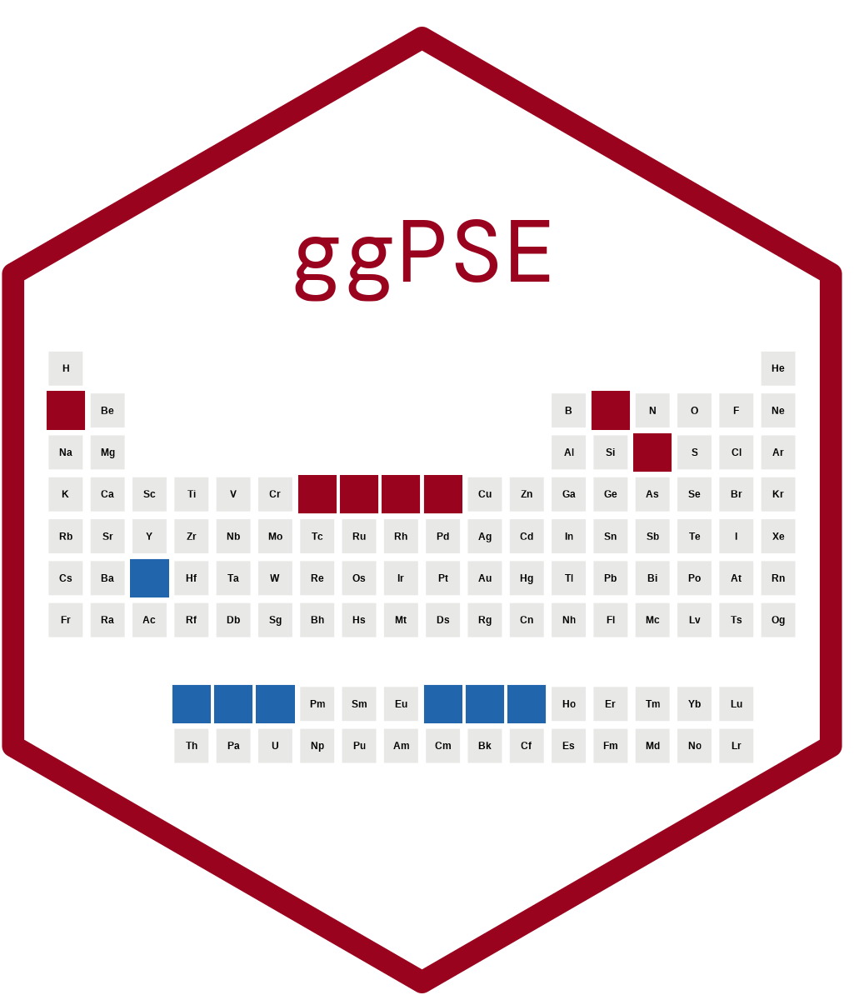

<!-- badges: start -->
[](https://github.com/VJGeiger/ggPSE/actions/workflows/r.yml)
[](https://www.repostatus.org/#active)[](https://lifecycle.r-lib.org/articles/stages.html#maturing)
[](https://opensource.org/licenses/MIT)
[](https://vjgeiger.github.io/ggPSE)
[](https://github.com/VJGeiger/ggPSE/releases)
[](https://github.com/VJGeiger/ggPSE)
[](https://github.com/VJGeiger/ggPSE)
<!-- badges: end -->

**ggPSE** is a [ggplot2 ](https://ggplot2.tidyverse.org/)-based toolkit for visualizing element-, group- or period-resolved data on the periodic table of elements. Every function returns a standard `ggplot2` object - so plots can be extended with themes, annotations, faceting, and `patchwork`.

---
## Disclaimer

This is an old script I wrote back in the day of my PhD thesis and never uploaded.
Furthermore, this is my first published R project, so, keep that in mind... 

---

## Contents

- [Installation](#installation)
- [Quick start](#quick-start)
- [Visualization modes](#visualization-modes)
  - [Numerated Tiles](#numerated-tiles)
  - [Display Selection](#show-selection)
  - [Highlight selected elements](#highlight-elements)
- [Built-in element data](#built-in-element-data)
- [Data visualization](#data-visualization)
  - [Color gradient](#color-gradient)
  - [Bubble plot](#bubble-plot)
  - [In-tile bars](#in-tile-bar-encoding)
  - [Donut charts](#donut-charts)
  - [Period and group profiles](#period-and-group-profiles)
  - [Interactive tooltips](#interactive-tooltips)
  - [Country badges](#country-of-origin-badges)
- [Themes](#themes)
- [Saving figures](#saving-figures)
- [Experimental features](#experimental-features)
- [Roadmap](#roadmap)
- [Citation](#citation)

---

## Installation

```r
# Install from GitHub (requires remotes)
remotes::install_github("VJGeiger/ggPSE")
```

If you want to plot with country flag badges :us: :it: :uk:, also install ggflags (not on CRAN, but GitHub):

```r
remotes::install_github("rensa/ggflags")
```

---

## Quick start

```r
library(ggPSE)

# Blank periodic table
ggPSE()
```
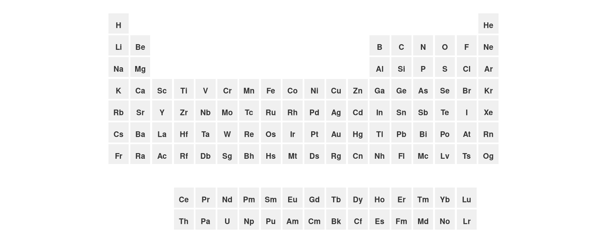

---

## Visualization modes
### Numerated Tiles
The numeration can be switched on with `show_atomic_number = TRUE`, default is `FALSE`to avoid crowded tiles.
```r
ggPSE(show_atomic_number = TRUE)
``` 
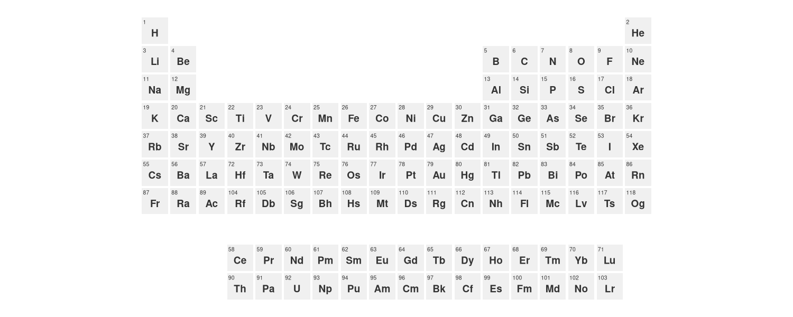
### Tile borders

Adapt the tile coloring as well as its borders for the whole PSE. 

```r
ggPSE(color_na = "white", tile_border = "gray40")
```


### Show Selection

If you are interested ind displaying only a part of the PSE you can specify this via
the `periods` and `groups` as a default lanthanides and actinides are always set to 
be displayed and have to be actively omitted by using `lanthanides = FALSE`.

```r
# Periods 4-6 with lanthanides
ggPSE(periods = c(4, 6), groups = c(3,4), lanthanides= FALSE, actinides = FALSE)
```


### Highlight elements

Color named subsets of elements with a legend entry per group.

```r
ggPSE(highlight = list(
  list(symbols = c("Li", "Co", "Ni", "Mn", "Fe", "P"),
       color   = "#2166ac",
       label   = "Battery metals"),
  list(symbols = c("Nd", "Dy", "Tb", "Pr", "La", "Ce"),
       color   = "#e63946",
       label   = "Rare earth magnets")
))
```
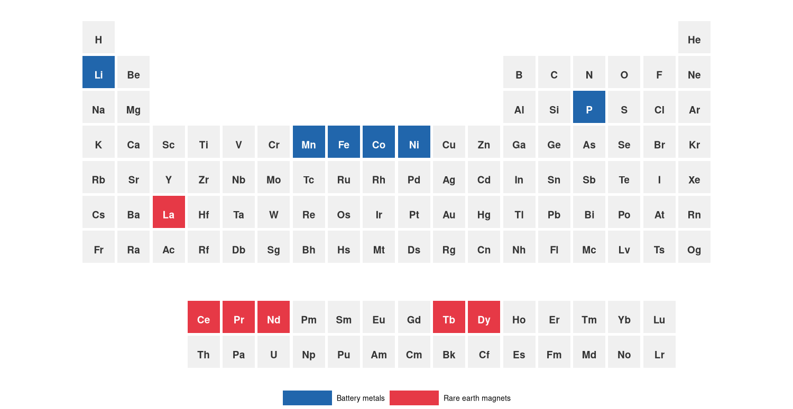

---

## Built-in element data

ggPSE ships with `ggpse_elements`, a data frame of 17 physical and chemical
properties for all 118 elements (IUPAC 2021, NIST WebBook, Pauling 1960):

```r
data(ggpse_elements)
ggPSE(ggpse_elements, value_col = "electronegativity",
      legend_title = "Electronegativity (Pauling)")
```
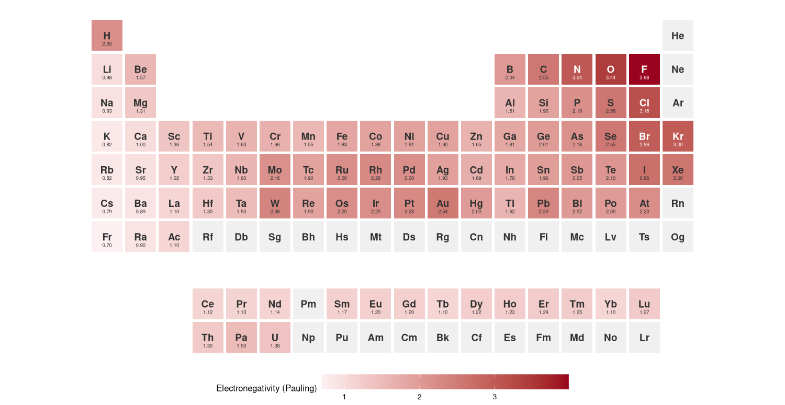

---


## Data visualization

### Color Gradient

Map any numeric variable to a fill color gradient across all elements.

```r
battery <- data.frame(
  symbol     = c("Li", "Co", "Ni", "Mn", "Fe", "P", "C"),
  importance = c(0.95, 0.88, 0.75, 0.60, 0.45, 0.40, 0.35)
)

ggPSE(battery,
      value_col    = "importance",
      color_low    = "#f7fbff",
      color_high   = "#08306b",
      legend_title = "Battery relevance")
```
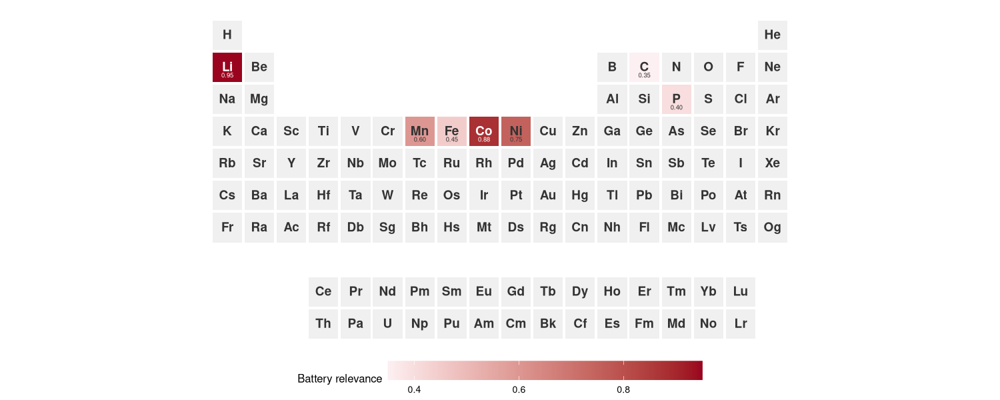

The mapping can also be applied to a selection of the PSE. 

```r
data(ggpse_elements)
ggPSE(ggpse_elements[ggpse_elements$block == "d", ],
      value_col = "density_g_cm3", legend_title = "Density (g/cm3)")
```
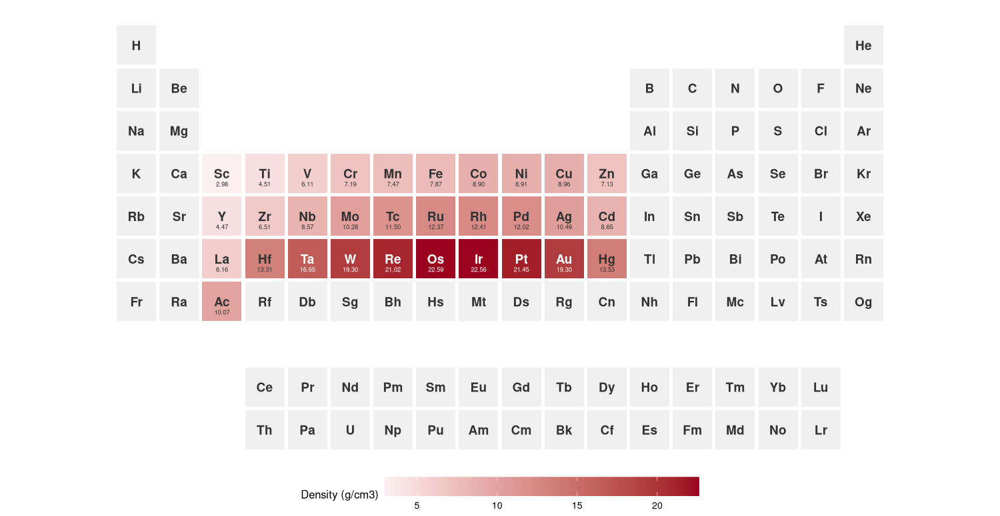

It is also possible to customize the ggplots to multigradient scales for better visualization.

```r
data(ggpse_elements)

ggPSE(ggpse_elements,
      value_col    = "density_g_cm3",
      color_low    = "#2166ac",   
      color_high   = "#a50026",   
      legend_title = "Density (g/cm³)") +
  ggplot2::scale_fill_gradientn(
    colours  = c("#2166ac", "#1a9850", "#a50026"),
    na.value = "#f0f0f0",
    name     = "Density (g/cm³)"
  ) +
  ggplot2::labs(title = "Elemental density across the periodic table") +
  ggplot2::theme(plot.title = ggplot2::element_text(hjust = 0.5, face = "bold"))
```
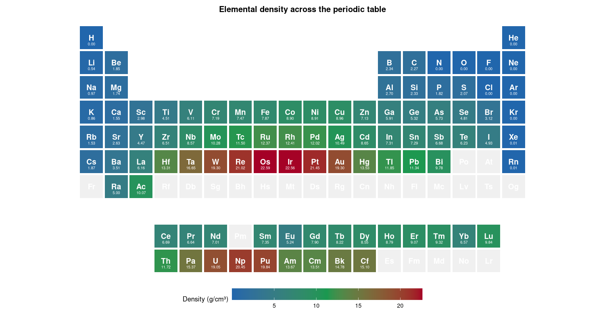

### Bubble plot

Map a numeric variable to bubble size.

```r
supply_risk <- data.frame(
  symbol = c("Li", "Co", "Nd", "Dy", "Pt", "Rh", "In", "Ga"),
  risk   = c(0.62, 0.91, 0.84, 0.88, 0.52, 0.70, 0.78, 0.65)
)
ggPSE_bubble(supply_risk, size_col = "risk", legend_title = "Supply risk")
```
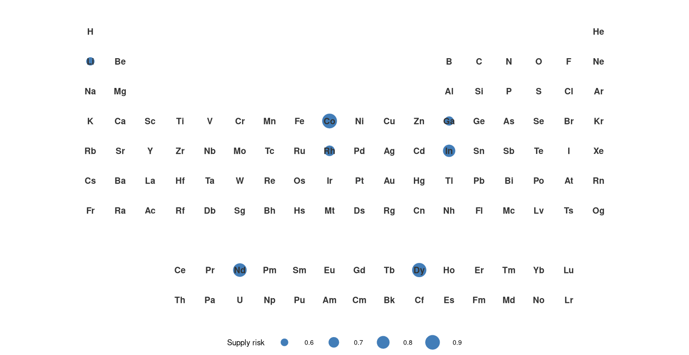

### In-tile bar encoding

Draw a proportional bar inside each tile growing from a chosen edge
(`"bottom"`, `"top"`, `"left"`, or `"right"`).

```r
ggPSE_bar(supply_risk, value_col = "risk",
          bar_side  = "bottom",
          bar_color = "#2166ac",
          legend_title = "Supply risk")
```

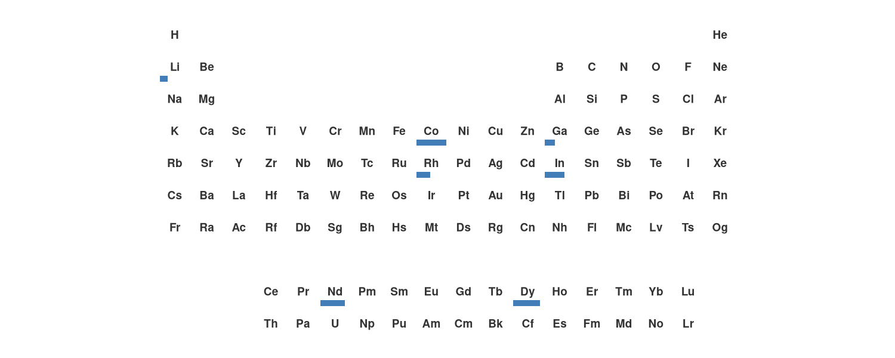

---

## Donut Charts

One can add donuts per field to display distributions with element resolution. 
With the `plot_all =TRUE` it is optional to display all elements even those without
data.

```r
supply <- data.frame(
   symbol   = c("Li","Li","Li", "Co","Co", "Nd","Nd", "Pt"),
   category = c("CL","AU","AR", "CD","AU", "CN","RU", "ZA"),
   share    = c(0.60, 0.30, 0.10, 0.70, 0.30, 0.80, 0.20, 1.00)
 )

ggPSE(groups = c(3,12)) |>
gPSE_donut(supply, category_col = "category", share_col = "share", plot_all = FALSE)
```

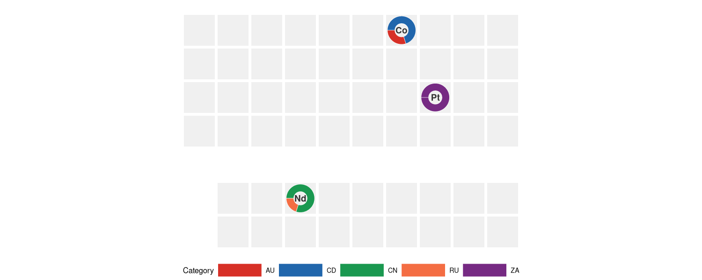

---

### Period and group profiles
The display of selected periods and rows with corresponding data can be achieved 
via the `ggPSE_profile()` function. Elements with no values are omitted.

```r
ggPSE_profile(ggpse_elements, value_col = "electronegativity", period = 6)

# or

ggPSE_profile(ggpse_elements, value_col = "electronegativity", group = 12)

# or

ggPSE_profile(ggpse_elements, value_col = "electronegativity", lanthanides = TRUE)

```
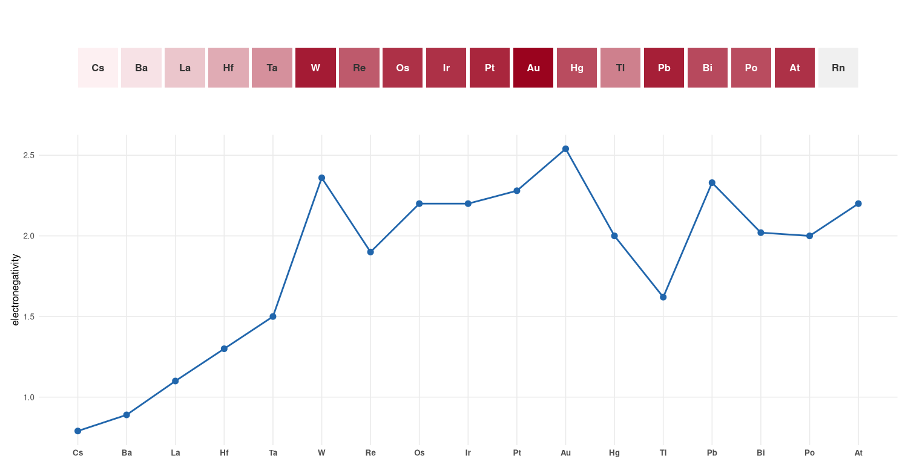

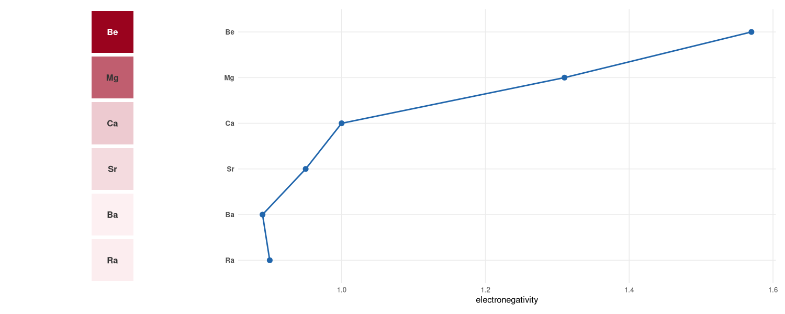

---

### Country-of-origin badges

Overlay country flags (via ggflags) or ISO 3166-1 alpha-2 text codes.
Up to three flags per tile are supported. These tiles can be displayed with a hierarchy
(1st-2nd-3rd "place"). A legend is optional and can be positioned around the plot. 

```r
supply <- data.frame(
  symbol  = c("Li", "Co", "Nd", "Pt"),
  country = c("CL", "CD", "CN", "ZA"),
  value   = c(0.70, 0.91, 0.85, 0.60)
)
ggPSE(supply, value_col = "value", legend_title = "Criticality") |>
  ggPSE_badge(supply, country_col = "country")
```
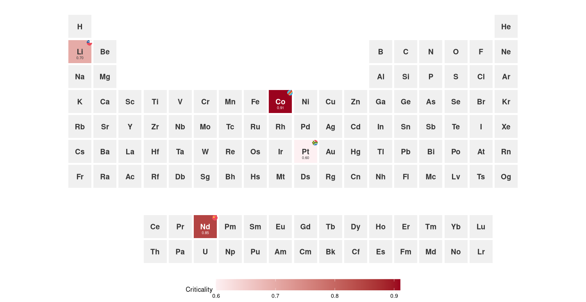

```r
supply_multi <- data.frame(
  symbol  = c("Li", "Li", "Co", "Co", "Co", "Nd", "Pt"),
  country = c("CL", "AU", "CD", "AU", "ZM", "CN", "ZA"),
  value   = c(0.70, 0.70, 0.91, 0.91, 0.91, 0.85, 0.60)
)

ggPSE(supply_multi, value_col = "value",
      color_high = "#b2182b", legend_title = "Criticality") |>
  ggPSE_badge(supply_multi, country_col = "country")
  
 ggPSE(supply_multi, value_col = "value") |>
     ggPSE_badge(supply_multi, country_col = "country",
                 hierarchy = TRUE, hierarchy_scale = c(1.0, 0.6, 0.5), show_legend = TRUE, legend_position = "bottom")
```


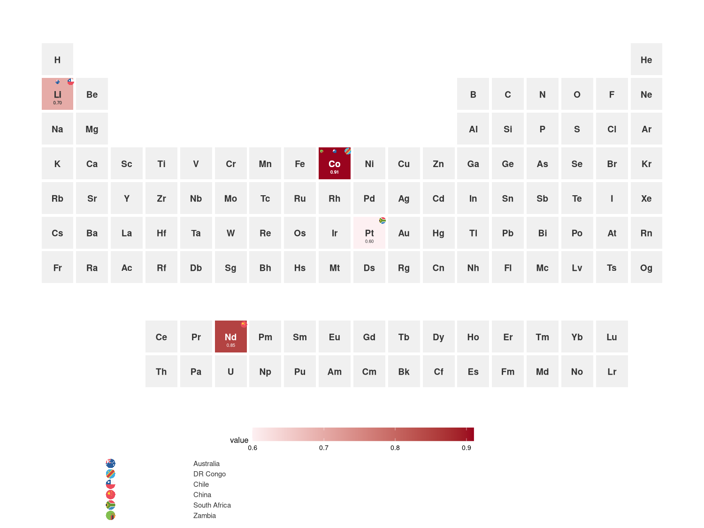
---

## Interactive plots 
The displayed values can be made into interactive plots with `ggPSE_interactive()`
👉 [Interactive periodic table example](https://vjgeiger.github.io/ggPSE/interactive.html)

```r
ggPSE_interactive(battery, value_col = "importance")

# or 

ggPSE_interactive(
  ggpse_elements,
  value_col    = "electronegativity",
  tooltip_cols = c("name", "atomic_weight", "block", "electronegativity"),
  legend_title = "Electronegativity (Pauling)"
)
```

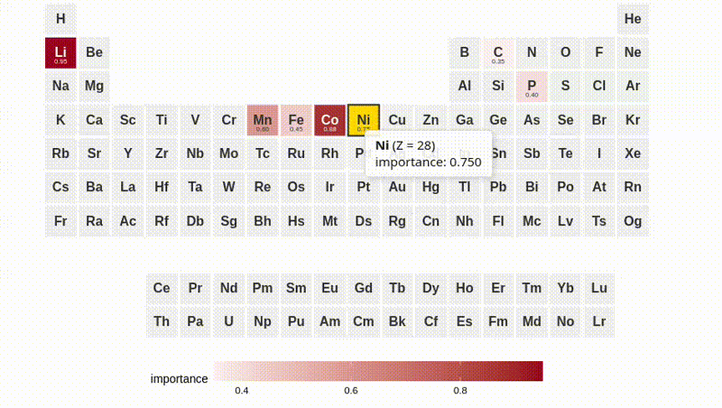

---

## Themes

There are four prebuilt themes available via `ggPSE_theme()`. 
| Theme | Description |
|---|---|
| `"minimal"` | White background, simple|
| `"dark"` | Dark plot background |
| `"publication"` | Minimal ink, transparent background, journal-ready |
| `"crazy"` | Random color per tile, reproducible with `seed` |

```r
# Minimal
ggPSE() |> ggPSE_theme("minimal")

# Publication
ggPSE(ggpse_elements, value_col = "electronegativity") |>
  ggPSE_theme("publication")

# Crazy — reproducible
ggPSE() |> ggPSE_theme("crazy", seed = 42)

```
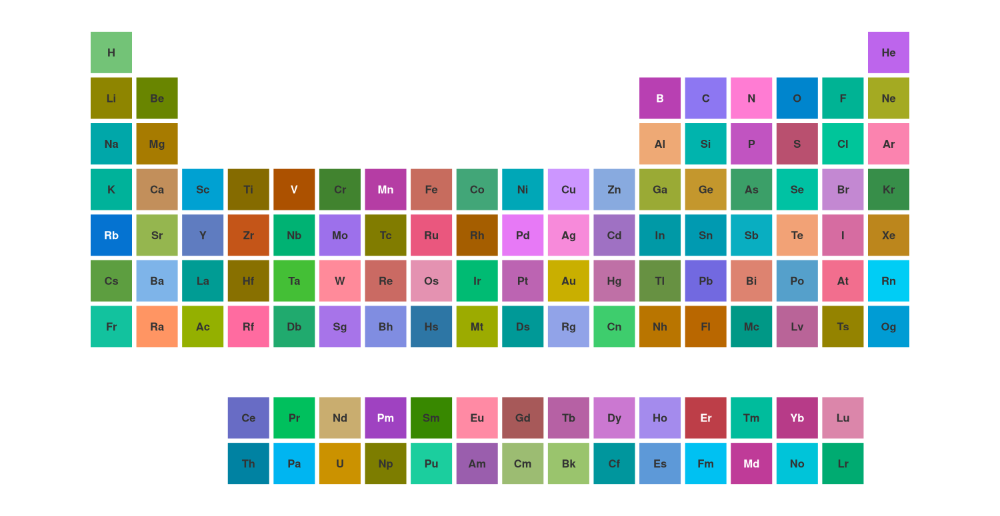

---

## Saving figures

Figures can be saved via the wrapper `ggPSE_save()` for ease. For more custom plots, 
`ggsave()` can be used as well.

```r
data(ggpse_elemts)
p <- ggPSE(ggpse_elements, value_col = "electronegativity")

ggPSE_save(p, "electronegativity.png")   # PNG 18x14cm at 400dpi
ggPSE_save(p, "electronegativity.pdf")   # vector PDF
ggPSE_save(p, "electronegativity.svg")   # web SVG
ggPSE_save(p, "electronegativity.png", width = 24, height = 9, dpi = 600)

```

---


## Experimental features

`ggPSE_sparkline()` and `ggPSE_spark_bar()` per-tile time series sparklines was 
deemed too unstable and in need of further development. 

Available on the `feature/sparkline` branch:

```r
remotes::install_github("VJGeiger/ggPSE@feature/sparkline")
```

---

## Roadmap

See [TODO](TODO) for roadmap and what's ahead. 

---

## Contributing 

Issues and pull requests welcome. Please open an issue before starting
significant work so we can discuss the approach first.

---

## Alternatives 

### R alternatives
- [periodicdata](https://github.com/solarchemist/periodicdata): Rich on dataset for the periodic system in R.
- [PeriodicTable](https://cran.r-project.org/web/packages/PeriodicTable/index.html): Simplest alternative for a PSE.

### python alternatives
- [mendeelv](https://pypi.org/project/mendeleev/): Rich-dataset, feature-rich and optional interactive visualization.


--- 

## Citation

If you use ggPSE in a publication, please cite it as:

```
Valentin Geiger (2026). ggPSE: Periodic Table Visualization with ggplot2.
R package version 0.2.0. https://github.com/VJGeiger/ggPSE
```

---

## Acknowledgement

This package was developed with assistance from 
[Claude](https://claude.ai) (Anthropic), including function design, debugging, documentation, and iterative development 
throughout the entire codebase.
