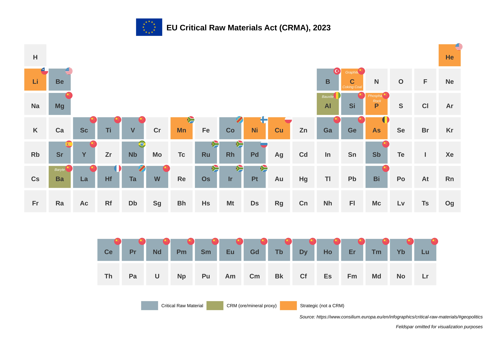

# PSE Plot Gallery

This is a collection of plots made with `ggPSE`, showcasing the
different ways per element-resolved data can be mapped onto the periodic
table (svg avaiable in the repo).

Click any image to view it at full resolution.

Plot 1: Mapping of the EU critical materials listed in the 2023 document
on CRM’s.
