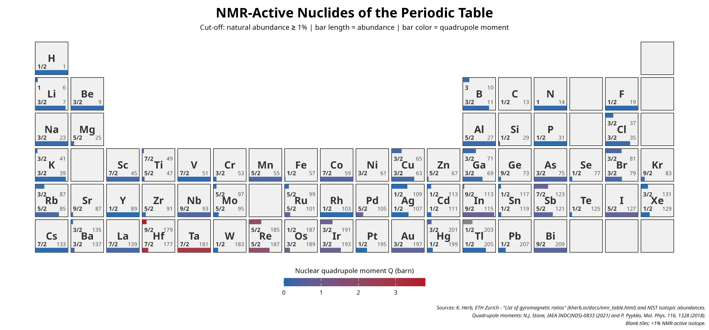
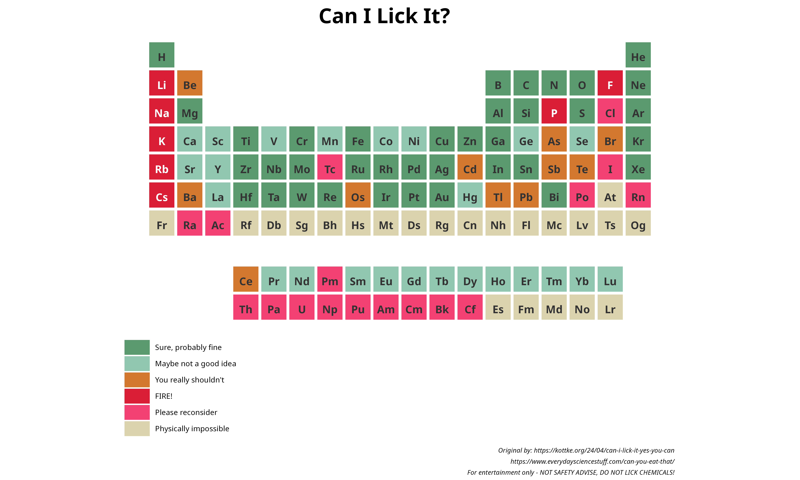
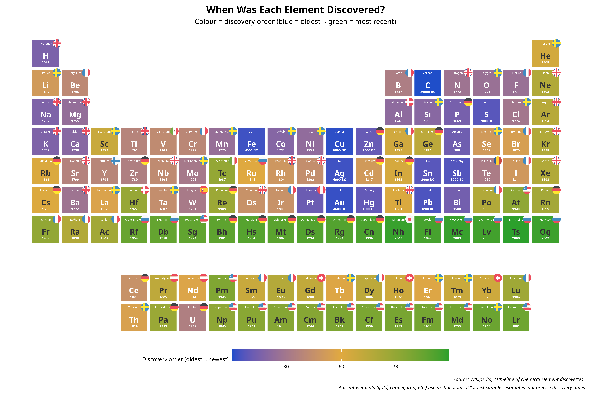
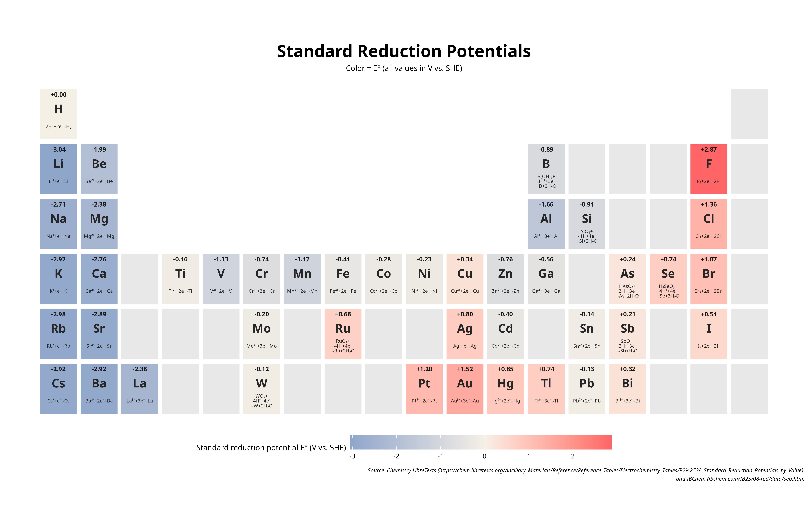
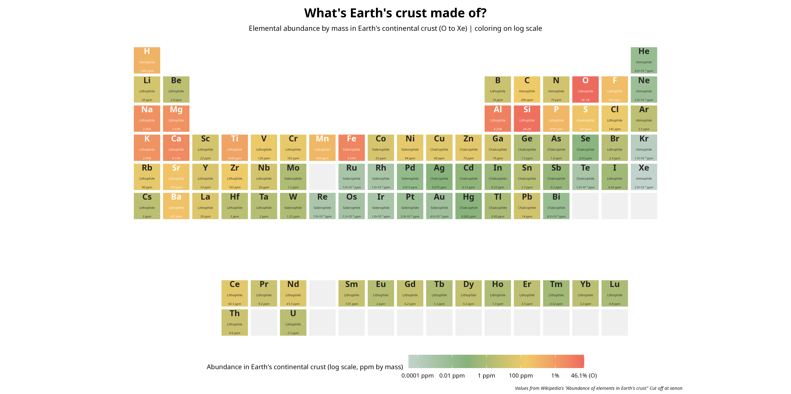
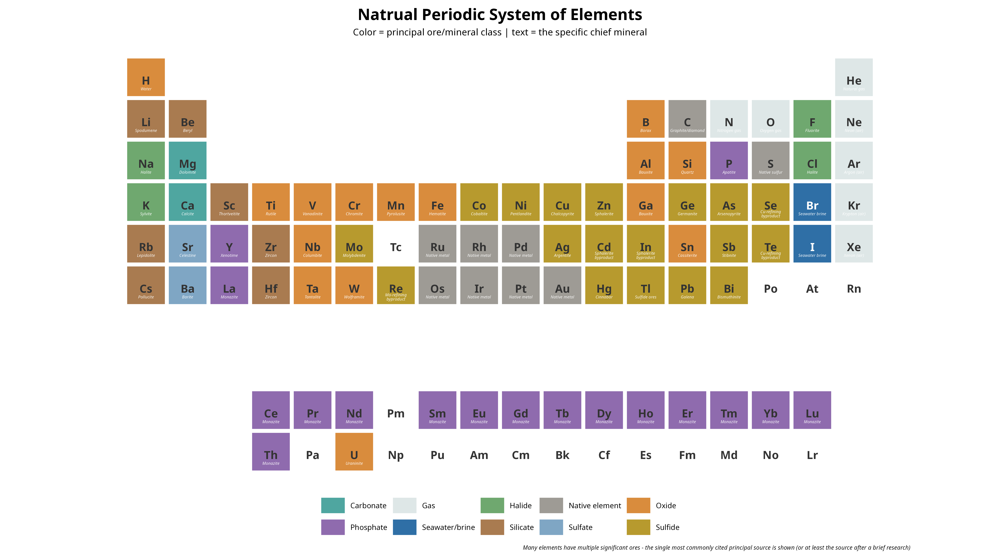
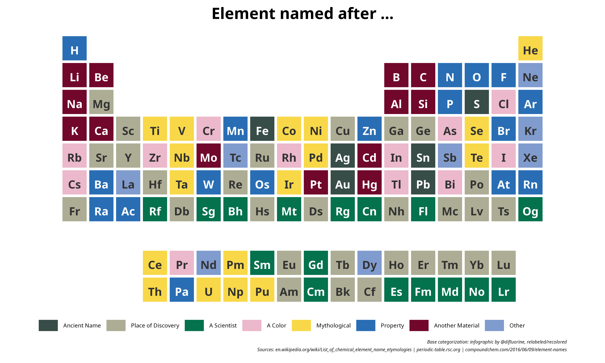
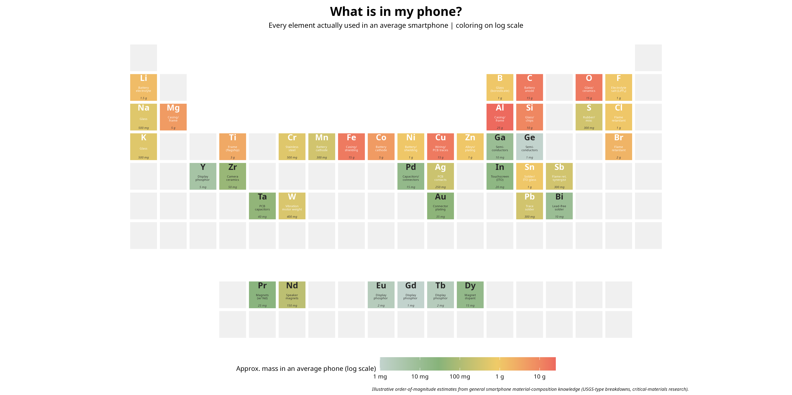
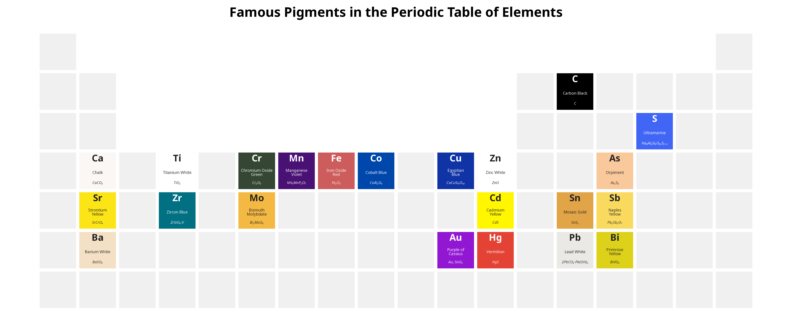

# PSE Plot Gallery

This is a collection of plots made with `ggPSE`, showcasing the
different ways per element-resolved data can be mapped onto the periodic
table (svg avaiable in the repo).

Click any image to view it at full resolution.

Plot 1: Mapping of the EU critical materials listed in the 2023 document
on CRM’s.

Plot 2: Mapping of NMR-active nucleides with quadropol moment.

Plot 3: Is it lickable? - PLEASE DO NOT LICK CHEMICALS!

Plot 4: Mapping of discovery year and country.

Plot 5: Mapping of standard reduction potentials and half-cell
reactions.

Plot 6: What’s Earth’s crust made out of? Elemental abundance of
elements in the Earth’s crust.

Plot 7: Visualization of how typically an element is found in nature.

Plot 8: Categorization of naming of each element of the periodic table
of elements.

Plot 9: What is my phone made out of? Semi-quantative visualization of
elements utilized in a phone.

Plot 10: Famous pigments attributed to an element.
