# Getting started with ggPSE

ggPSE provides ggplot2-based periodic table visualizations. Every
function returns a standard ggplot2 object, so you can add themes,
annotations, and combine plots with patchwork as usual.

## Basic gradient map

Supply a data frame with element symbols and a numeric column.
[`ggPSE()`](https://vjgeiger.github.io/ggPSE/reference/ggPSE.md) maps
the column to a fill gradient and returns a standard ggplot2 object.

``` r

battery <- data.frame(
  symbol     = c("Li", "Co", "Ni", "Mn", "Fe", "P", "C"),
  importance = c(0.95, 0.88, 0.75, 0.60, 0.45, 0.40, 0.35)
)
ggPSE(battery, value_col = "importance", legend_title = "Battery relevance")
```


Elements with no data appear in neutral grey. Because the result is a
plain ggplot2 object, you can keep adding layers:

``` r

ggPSE(battery,
      value_col    = "importance",
      color_low    = "#f7fbff",
      color_high   = "#08519c",
      legend_title = "Battery relevance") +
  labs(title = "Critical elements for Li-ion batteries") +
  theme(plot.title = element_text(size = 11, face = "bold", hjust = 0.5))
```


## Subsetting the table

Use `groups`, `periods`, `lanthanides`, and `actinides` to display only
a portion of the periodic table.

``` r

# Transition metals only
ggPSE(battery,
      value_col   = "importance",
      groups      = c(3, 12),
      periods     = c(4, 6),
      lanthanides = FALSE,
      actinides   = FALSE,
      legend_title = "Battery relevance")
```

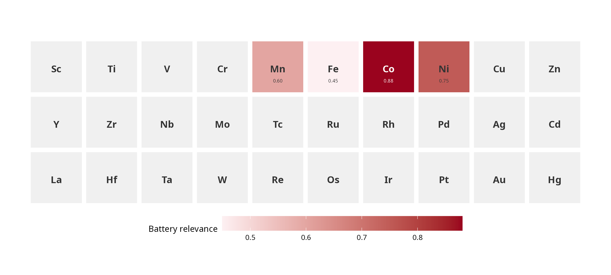

``` r

# Full table without lanthanides and actinides
ggPSE(battery,
      value_col   = "importance",
      lanthanides = FALSE,
      actinides   = FALSE,
      legend_title = "Battery relevance")
```


## Highlighting element groups

The `highlight` parameter colors groups of elements and adds a legend
entry for each group.

``` r

ggPSE(highlight = list(
  list(symbols = c("Li", "Co", "Ni", "Mn", "Fe", "P"),
       color   = "#2166ac",
       label   = "Battery metals"),
  list(symbols = c("Nd", "Dy", "Tb", "Pr", "La", "Ce"),
       color   = "#e63946",
       label   = "Rare earth magnets")
))
```


## Bubble size encoding

[`ggPSE_bubble()`](https://vjgeiger.github.io/ggPSE/reference/ggPSE_bubble.md)
maps a numeric column to bubble size on a clean white background.

``` r

supply_risk <- data.frame(
  symbol = c("Li", "Co", "Nd", "Dy", "Pt", "Rh", "In", "Ga"),
  risk   = c(0.62, 0.91, 0.84, 0.88, 0.52, 0.70, 0.78, 0.65)
)
ggPSE_bubble(supply_risk, size_col = "risk",
             bubble_color = "#d73027", legend_title = "Supply risk score")
```


## In-tile bar encoding

[`ggPSE_bar()`](https://vjgeiger.github.io/ggPSE/reference/ggPSE_bar.md)
draws a proportional bar inside each tile growing from a chosen edge.

``` r

ggPSE_bar(supply_risk, value_col = "risk",
          bar_side     = "bottom",
          bar_color    = "#2166ac",
          legend_title = "Supply risk score")
#> Warning: ggPSE_bar() draws no legend; 'legend_title' is ignored.
```

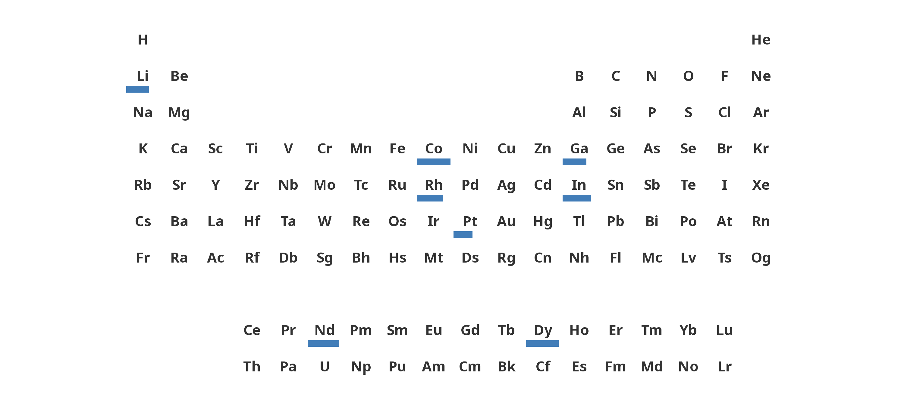

## Donut charts per tile

[`ggPSE_donut()`](https://vjgeiger.github.io/ggPSE/reference/ggPSE_donut.md)
draws a small donut or pie chart inside each tile showing a categorical
breakdown — for example supply mix by country or phase composition.
Requires the `ggforce` package.

``` r

supply <- data.frame(
  symbol   = c("Li","Li","Li", "Co","Co", "Nd","Nd", "Pt"),
  category = c("CL","AU","AR", "CD","AU", "CN","RU", "ZA"),
  share    = c(0.60, 0.30, 0.10, 0.70, 0.30, 0.80, 0.20, 1.00)
)

ggPSE() |>
  ggPSE_donut(supply, category_col = "category", share_col = "share",
              legend_title = "Producer")
```


Combine with a gradient fill to encode two variables simultaneously:

``` r

# Note: combining gradient fill with donut charts requires ggnewscale
# to avoid scale conflicts - planned for a future release
criticality <- data.frame(
  symbol = c("Li", "Co", "Nd", "Pt"),
  value  = c(0.70, 0.91, 0.85, 0.60)
)
ggPSE(criticality, value_col = "value", legend_title = "Criticality") |>
  ggPSE_donut(supply, category_col = "category", share_col = "share",
              legend_title = "Producer")
```

## Period and group profiles

[`ggPSE_profile()`](https://vjgeiger.github.io/ggPSE/reference/ggPSE_profile.md)
extracts a single period, group, or f-block row and combines it with a
line plot of a numeric property. Requires `patchwork`.

``` r

data(ggpse_elements)
ggPSE_profile(ggpse_elements, value_col = "electronegativity", period = 2)
```

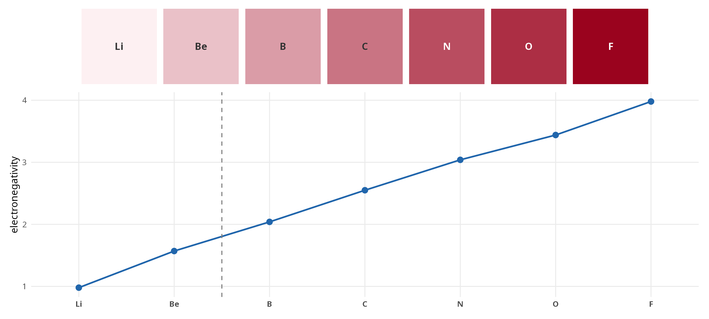

``` r

ggPSE_profile(ggpse_elements, value_col = "atomic_radius_pm", group = 1)
```

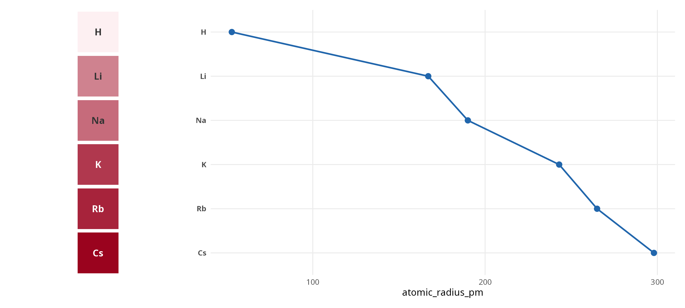

``` r

ggPSE_profile(ggpse_elements, value_col = "electronegativity",
              lanthanides = TRUE)
```

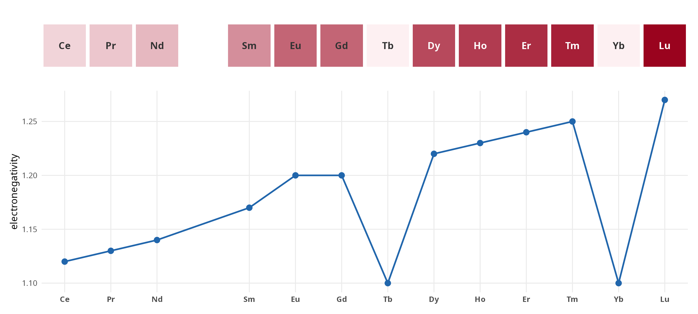

## Country-of-origin badges

[`ggPSE_badge()`](https://vjgeiger.github.io/ggPSE/reference/ggPSE_badge.md)
overlays country flags (via the optional ggflags package) or ISO 3166-1
alpha-2 text codes. Multiple countries per element are supported — up to
three flags per tile.

``` r

supply_single <- data.frame(
  symbol  = c("Li", "Co", "Nd", "Pt", "Cu", "Ni", "Ga", "In"),
  country = c("CL", "CD", "CN", "ZA", "CL", "PH", "CN", "CN"),
  value   = c(0.70, 0.91, 0.85, 0.60, 0.50, 0.55, 0.80, 0.75)
)
ggPSE(supply_single, value_col = "value",
      color_high = "#b2182b", legend_title = "Criticality") |>
  ggPSE_badge(supply_single, country_col = "country")
```


Use `hierarchy = TRUE` to scale flags by importance order and
`show_legend = TRUE` to append a country legend. Requires `patchwork`.

``` r

supply_multi <- data.frame(
  symbol  = c("Li","Li","Li", "Co","Co", "Nd","Nd"),
  country = c("CL","AU","AR", "CD","AU", "CN","RU"),
  value   = c(0.70, 0.70, 0.70, 0.91, 0.91, 0.85, 0.85)
)
ggPSE(supply_multi, value_col = "value", legend_title = "Criticality") |>
  ggPSE_badge(supply_multi, country_col = "country",
              hierarchy = TRUE, show_legend = TRUE)
```

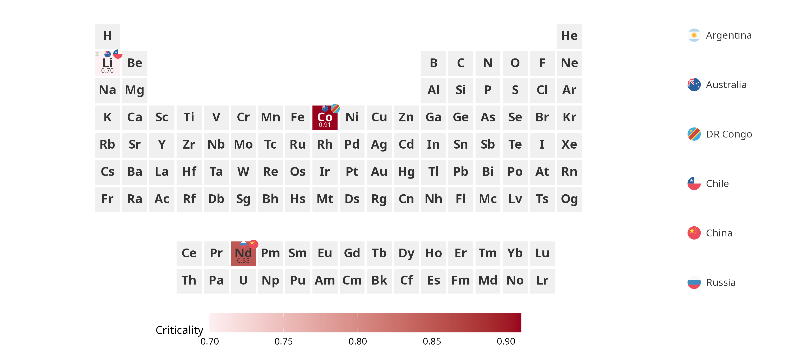

Install ggflags for flag icons:

``` r

remotes::install_github("rensa/ggflags")
```

## Themes

[`ggPSE_theme()`](https://vjgeiger.github.io/ggPSE/reference/ggPSE_theme.md)
applies a pre-built visual theme to any ggPSE plot.

``` r

ggPSE(battery, value_col = "importance") |>
  ggPSE_theme("minimal")
```

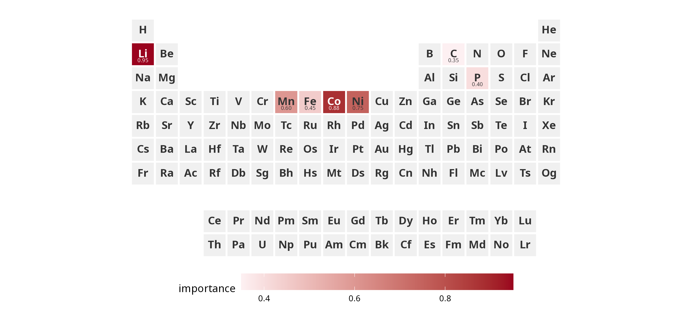

``` r

ggPSE(battery, value_col = "importance") |>
  ggPSE_theme("publication")
```

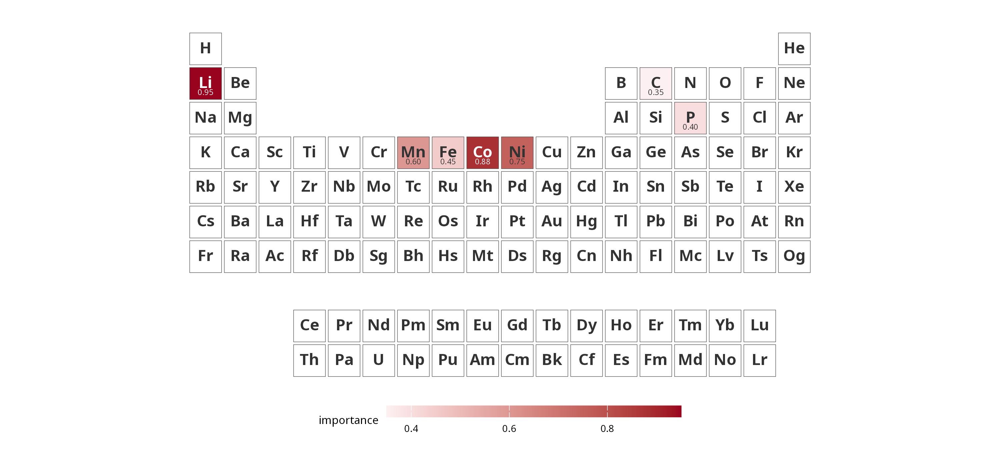

``` r

ggPSE() |> ggPSE_theme("crazy", seed = 42)
```

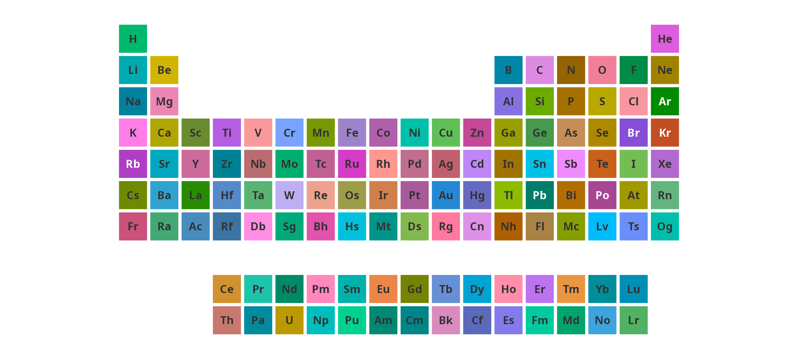

| Theme           | Description                                        |
|-----------------|----------------------------------------------------|
| `"minimal"`     | Clean white background, good for presentations     |
| `"dark"`        | Dark plot background with light legend             |
| `"publication"` | Minimal ink, transparent background, journal-ready |
| `"crazy"`       | Random color per tile, reproducible with `seed`    |

## Interactive tooltips

[`ggPSE_interactive()`](https://vjgeiger.github.io/ggPSE/reference/ggPSE_interactive.md)
adds hover tooltips via the `ggiraph` package. Renders in HTML
documents, Shiny apps, and RStudio Viewer.

``` r

data(ggpse_elements)
ggPSE_interactive(
  ggpse_elements,
  value_col    = "electronegativity",
  tooltip_cols = c("name", "atomic_weight", "block", "electronegativity"),
  legend_title = "Electronegativity (Pauling)"
)
```

## Using the built-in element data

ggPSE ships with `ggpse_elements`, a data frame of 17 physical and
chemical properties for all 118 elements sourced from IUPAC 2021 and
NIST WebBook.

``` r

data(ggpse_elements)
ggPSE(ggpse_elements, value_col = "electronegativity",
      color_low    = "#f7f7f7",
      color_high   = "#d73027",
      legend_title = "Electronegativity (Pauling)")
```

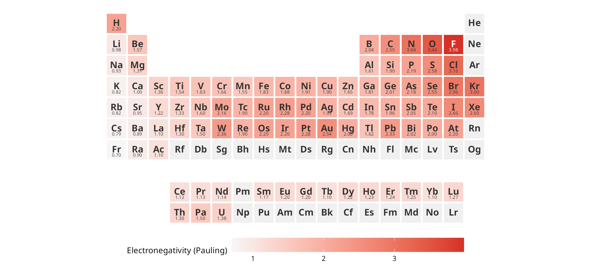

``` r

ggPSE(ggpse_elements, value_col = "melting_point_K",
      color_high   = "#08519c",
      legend_title = "Melting point (K)")
```

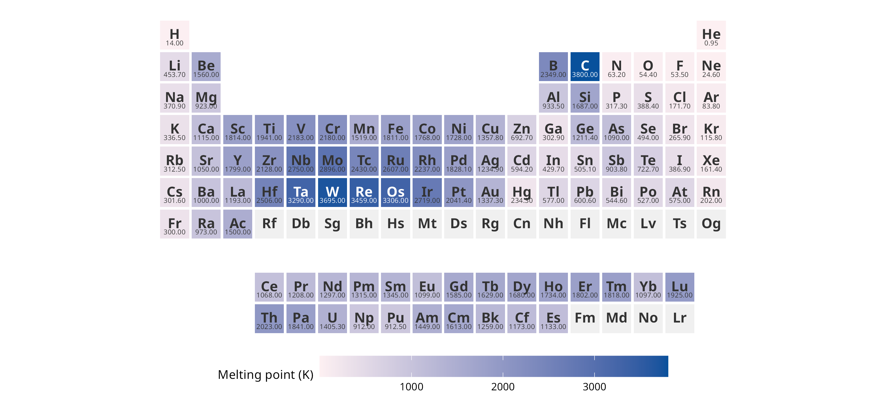

## Saving figures

Use
[`ggPSE_save()`](https://vjgeiger.github.io/ggPSE/reference/ggPSE_save.md)
for sensible periodic table defaults, or `ggsave()` directly for full
control.

``` r

p <- ggPSE(battery, value_col = "importance")

# Convenience wrapper with PSE-optimised defaults
ggPSE_save(p, "battery.png")
ggPSE_save(p, "battery.pdf")

# Full control with ggsave
ggsave("battery.png", p, width = 18, height = 8, units = "cm", dpi = 300)
ggsave("battery.svg", p, width = 18, height = 8, units = "cm")
```
